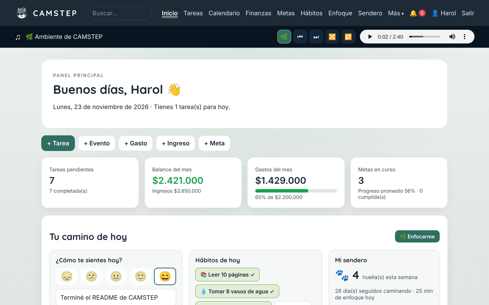
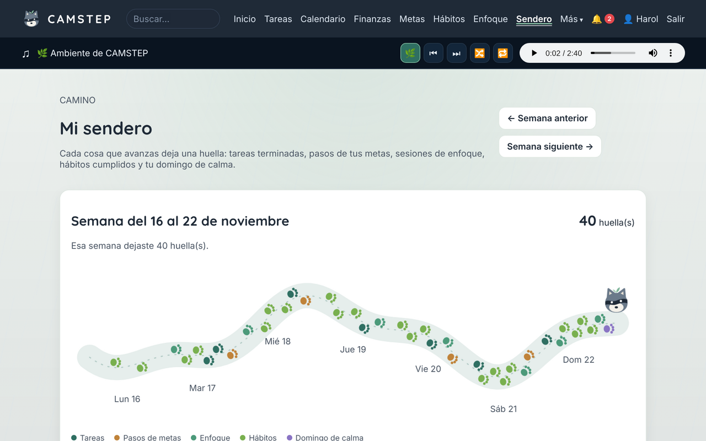
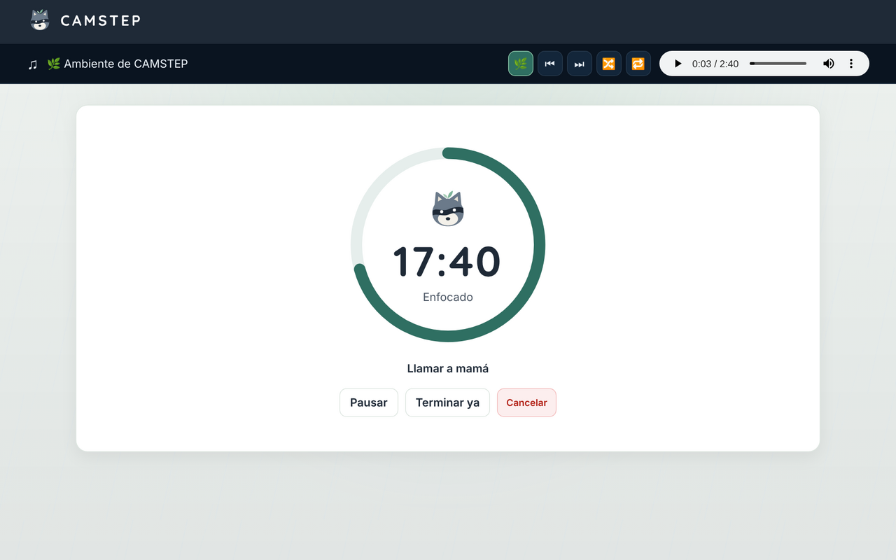
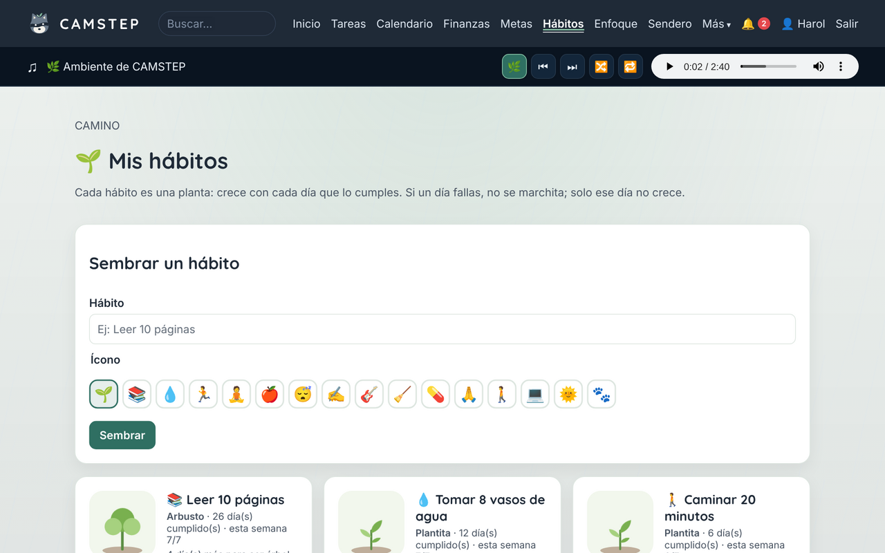
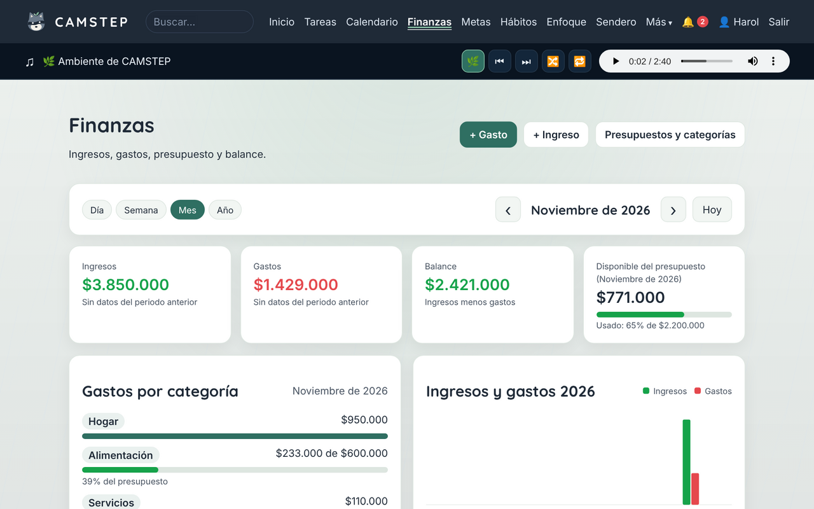
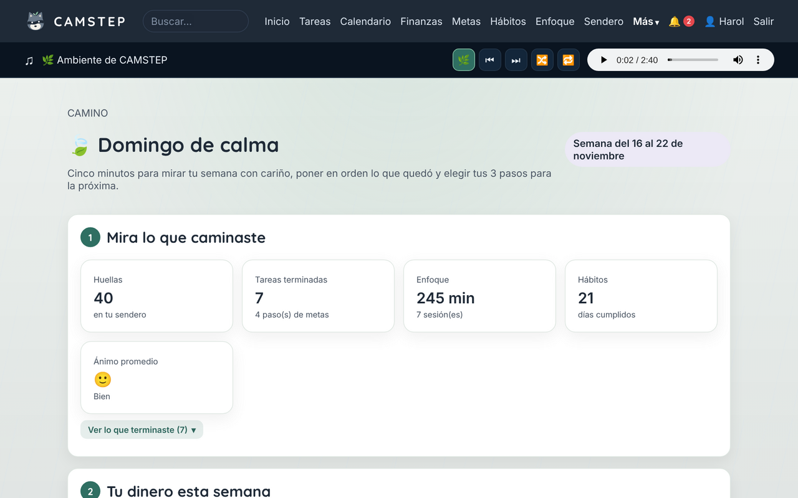
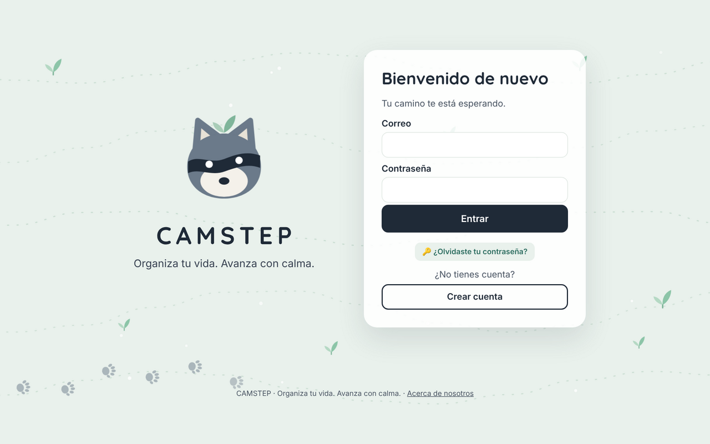
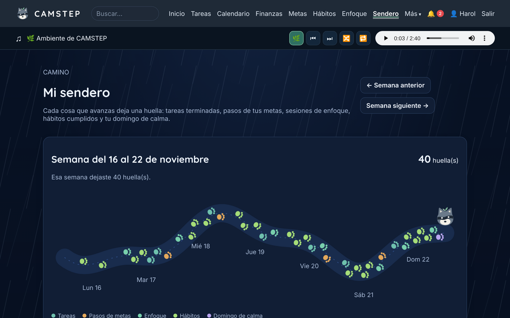
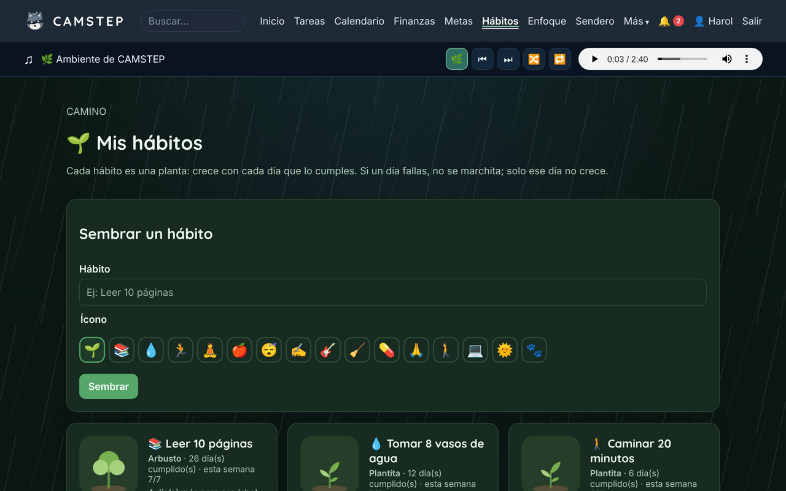
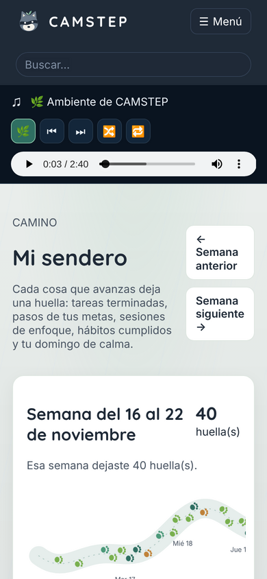

<p align="center">
  
</p>

<h1 align="center">CAMSTEP</h1>

<p align="center"><b>Organiza tu vida. Avanza con calma.</b></p>

<p align="center">
  Aplicación web de organización personal: tareas, calendario, finanzas, metas, hábitos y bienestar en un solo lugar sereno.
</p>

<p align="center">
  
  
  
  
  
  
</p>

<p align="center">
  
</p>

---

## ¿Qué es CAMSTEP?

CAMSTEP une **CAM** (de *camino*) y **STEP** (*paso*): tu vida es un camino y se recorre paso a paso. Es un proyecto personal que reúne en una sola app lo que normalmente está regado en varias: pendientes, citas, gastos, metas y hábitos. Su sello es la calma: en vez de castigarte, muestra lo que avanzaste.

Cada usuario tiene su propia cuenta, y sus datos solo los ve él.

## Capturas

| Mi sendero | Modo enfoque |
|---|---|
|  |  |
| **Hábitos que crecen** | **Finanzas** |
|  |  |
| **Domingo de calma** | **Inicio de sesión** |
|  |  |

**Seis temas y diseño adaptable al celular:**

| Tema Midnight | Tema Nature | Celular |
|---|---|---|
|  |  |  |

## Funciones

**Organización**

- **Tareas** con prioridad, fecha, filtros, búsqueda y orden.
- **Calendario** por mes, semana o día, con eventos de colores y recordatorios.
- **Metas** con progreso, fecha límite y pasos.
- **Buscador** global en toda la app.
- **Avisos** dentro de la app y del navegador: tareas por vencer, eventos, metas y presupuesto.

**Dinero**

- Gastos e ingresos por categoría, con categorías propias.
- Presupuesto mensual, general o por categoría, con alertas.
- Informes por semana, mes o año, con gráficas y exportación a CSV.

**El camino (bienestar y progreso)**

- **Mi sendero:** cada cosa que avanzas deja una huella del mapache en el camino de la semana.
- **Modo enfoque:** temporizador Pomodoro con pantalla tranquila y música ambiente. Sigue corriendo aunque cambies de sección.
- **Hábitos** que crecen como plantas (semilla → árbol en flor) y nunca se marchitan.
- **¿Cómo te sientes hoy?:** registro diario de ánimo con una nota de algo bueno del día.
- **Domingo de calma:** repaso guiado de la semana y tus 3 pasos para la siguiente.
- **Frases del camino:** más de 360 frases de autores clásicos, refranes y mensajes propios, sin repetirse.

**Experiencia**

- Seis temas: Light, Black, Midnight, Galaxy, Ocean y Nature. También fondo propio y lluvia animada.
- Música: tus canciones con listas de reproducción, **SoundCloud** integrado y una **música ambiente** original.
- La música no se corta al cambiar de sección: la navegación no recarga la página.
- **App instalable (PWA)** en el celular o el computador, con página sin conexión.
- Bienvenida animada, transiciones suaves y respeto por "reducir movimiento".

## Tecnologías

| Capa | Herramienta |
|---|---|
| Backend | C# 12, ASP.NET Core MVC (.NET 8) |
| Datos | Entity Framework Core 8 + SQLite |
| Vistas | Razor, HTML y CSS propios |
| Frontend | JavaScript puro, sin frameworks ni librerías |
| App instalable | Service worker + Web App Manifest |
| Correo | SMTP (recuperación de contraseña) |

## Seguridad

- Contraseñas guardadas con hash (`PasswordHasher`), nunca en texto plano.
- Cada consulta se filtra por el dueño en el servidor: nadie puede ver ni tocar datos de otro usuario cambiando un número en la URL.
- Tokens antifalsificación en todos los formularios.
- Bloqueo temporal tras varios intentos fallidos de inicio de sesión.
- Recuperación de contraseña con enlace de un solo uso que vence en 1 hora.
- Cabeceras de seguridad y política de contenido (CSP) estricta: el único contenido externo permitido es el reproductor oficial de SoundCloud.
- Los archivos subidos se validan por su contenido real, se guardan fuera de la carpeta pública y solo los ve su dueño.
- Copia de seguridad automática de la base antes de cualquier cambio en su estructura.
- Política de privacidad y términos de uso según la Ley 1581 de 2012 (Colombia); cada cuenta guarda la fecha en que los aceptó.
- Límite de cuentas nuevas por hora y de espacio de música por usuario.
- Al eliminar la cuenta se borran todos sus datos y archivos.

## Cómo ejecutarla

**Requisitos:** [SDK de .NET 8](https://dotnet.microsoft.com/download/dotnet/8.0) y Visual Studio 2022 o posterior (o solo la terminal).

1. Clona el repositorio, o descárgalo con **Code → Download ZIP**.
2. Abre `Camstep.sln` en Visual Studio y pulsa **F5**.
3. Se abre en `http://localhost:5070`. Crea tu cuenta y listo: la base de datos `camstep.db` se crea sola la primera vez.

Desde la terminal:

```bash
dotnet run
```

**Para probarla en el celular** (misma red WiFi): usa el perfil **"CAMSTEP (red local - celular)"** y abre `http://IP-DE-TU-PC:5070` en el navegador del celular.

### Configuración

Todo se configura en `appsettings.json`:

| Sección | Para qué sirve |
|---|---|
| `ConnectionStrings:DefaultConnection` | Ruta de la base SQLite (por defecto `camstep.db`). |
| `About` | Correo de contacto y enlaces de GitHub y LinkedIn que aparecen en "Acerca de". Si están vacíos, no se muestran. |
| `Smtp` | Servidor de correo para "Olvidé mi contraseña". |
| `Storage:MusicQuotaMB` | Espacio de música por usuario, en MB (por defecto 300). |
| `Security:MaxRegistrationsPerHour` | Cuentas nuevas por hora desde una misma conexión (por defecto 5). |
| `DataRoot` | Carpeta donde se guardan la base, los archivos subidos, las claves y los respaldos. Si no se pone, es la carpeta de la app. |

> **No guardes contraseñas en `appsettings.json`.** La del correo va en una variable de entorno: `Smtp__Password`. Así nunca termina en GitHub.

### Publicarla en internet

El proyecto trae un `Dockerfile` listo. La forma recomendada es **Railway**: conectas este repositorio, agregas un volumen en `/data` y generas el dominio con HTTPS. El paso a paso está en [docs/GUIA_DE_PUBLICACION.md](docs/GUIA_DE_PUBLICACION.md).

## Estructura del proyecto

```text
Camstep/
├── Controllers/       Una por sección (Tareas, Finanzas, Metas, Hábitos, Enfoque, Sendero…)
├── Data/              AppDbContext, SchemaUpdater (cambios de estructura con respaldo)
├── Filters/           Inicio de sesión obligatorio en toda la app
├── Models/            Entidades y modelos de las vistas
├── Services/          Lógica compartida: sendero, frases, avisos, correo, formatos…
├── ViewComponents/    La campana de avisos
├── Views/             Vistas Razor
├── wwwroot/           CSS, JavaScript, fuentes, imágenes, música ambiente, service worker
├── docs/              Manuales, guía de publicación, diagramas y capturas
└── Dockerfile         Para publicarla en un servidor con contenedores (Railway)
```

## Documentación

- [Manual de usuario](docs/MANUAL_DE_USUARIO.md): cómo usar cada sección.
- [Documentación técnica](docs/DOCUMENTACION_TECNICA.md): arquitectura, modelo de datos, seguridad y decisiones.
- [Guía de publicación](docs/GUIA_DE_PUBLICACION.md): cómo publicarla en internet y configurar el correo.
- [Identidad de la marca](docs/MARCA_CAMSTEP.md): misión, visión, valores, logo y colores.

## Datos, música y fuentes

- `camstep.db`: la base de datos. `backups/`: copias automáticas antes de cada cambio de estructura. `App_Data/`: fondos y música de cada usuario y las claves de las sesiones. Ninguno de estos se sube al repositorio (`.gitignore`).
- Si vienes de una versión anterior que usaba `vidaenorden.db`, al arrancar la app la copia sola a `camstep.db` y deja la original como respaldo.
- La **música ambiente** es original: se generó por código para CAMSTEP, sin muestras de terceros. La app no descarga música de ninguna plataforma: cada quien sube sus propios archivos, o escucha SoundCloud con su reproductor oficial.
- Las fuentes **Quicksand** e **Inter** van incluidas con su licencia libre (SIL OFL) en `wwwroot/fonts`.

## Calidad

Durante el desarrollo, la app se probó con pruebas automáticas de extremo a extremo, tanto por HTTP como en un navegador real:

- Permisos entre usuarios, validaciones y formularios.
- Instalación nueva y actualización desde bases de datos anteriores.
- Navegación sin recarga, música, modo enfoque y frases.
- Diseño en celular y en los distintos temas.
- Modo producción: HTTPS detrás de un proxy, cookies seguras y datos en una carpeta aparte.

## Autor

**Harol Teran**, desarrollador de software junior y QA tester. Bogotá, Colombia.

CAMSTEP es un proyecto personal, diseñado y desarrollado de principio a fin por mí.

---

<p align="center"><sub>Hecho con calma en Bogotá 🦝🌱</sub></p>
