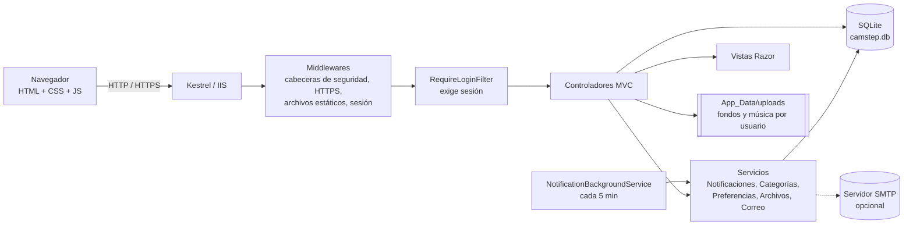
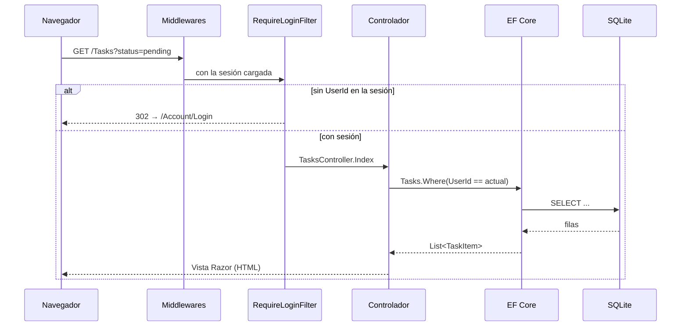
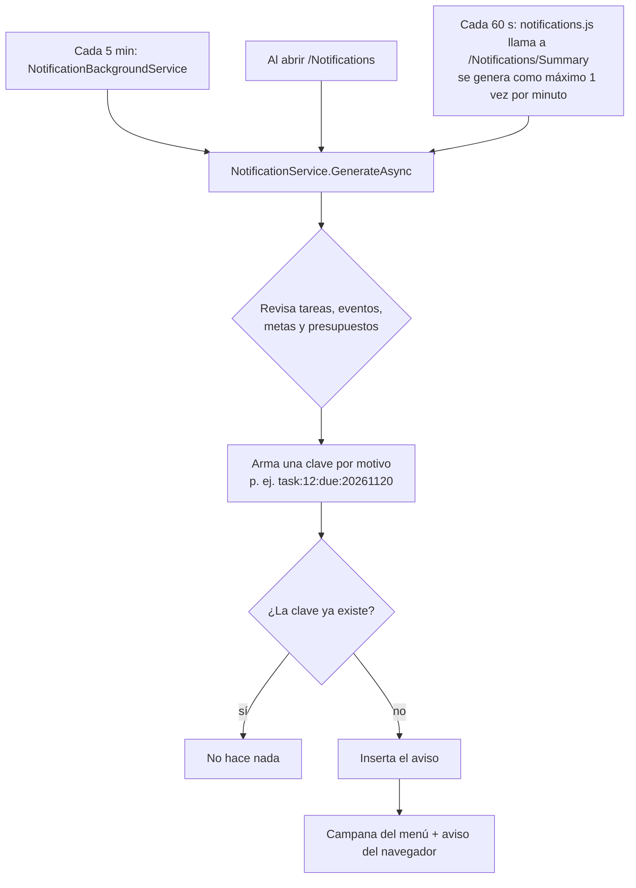

# CAMSTEP: Documentación técnica

## 1. Resumen

| Aspecto | Detalle |
| --- | --- |
| Tipo | Aplicación web de organización personal, con varios usuarios y los datos de cada uno separados |
| Lenguaje | C# 12 |
| Framework | ASP.NET Core MVC (.NET 8) |
| Vistas | Razor (CSHTML), CSS propio y JavaScript sin librerías |
| Base de datos | SQLite (`camstep.db`) con Entity Framework Core 8.0.20 |
| Paquetes NuGet | `Microsoft.EntityFrameworkCore.Sqlite` y `Microsoft.EntityFrameworkCore.Design`. No hay más dependencias |
| Autenticación | Sesión de ASP.NET Core (`UserId`), con contraseñas guardadas con `PasswordHasher<User>` (PBKDF2) |

> Nota: los diagramas están escritos en Mermaid. Se ven como dibujos en GitHub, en Visual Studio Code (con la extensión "Markdown Preview Mermaid Support") y en https://mermaid.live.

---

## 2. Arquitectura



### Patrón MVC

- **Modelos** (`Models/`): las entidades de la base de datos y los ViewModels de cada pantalla.
- **Vistas** (`Views/`): Razor. La plantilla común es `Views/Shared/_Layout.cshtml`, que contiene el menú, el reproductor, la lluvia, la campana de avisos y el buscador.
- **Controladores** (`Controllers/`): todos los privados heredan de `AppController`, que expone `CurrentUserId` y `RedirectBack`.

### Recorrido de una solicitud



---

## 3. Estructura del proyecto

```
Camstep/
├── Controllers/   Account, Profile, Home, Tasks, Calendar, Events, Finance, Expenses,
│                  Incomes, Goals, Reports, Search, Notifications, Customization, Music
├── Data/          AppDbContext.cs, SchemaUpdater.cs
├── Filters/       RequireLoginFilter.cs (+ atributo [AllowGuest])
├── Models/        entidades y ViewModels
├── Services/      NotificationService (+ servicio en segundo plano), PreferenceSession,
│                  Categories, LoginThrottle, EmailSender, FileSignature, UserFiles, Format, Text
├── ViewComponents/ NotificationBellViewComponent (campana del menú)
├── Views/         vistas Razor por sección
├── wwwroot/       css/site.css, js/site.js, js/player.js, js/notifications.js, favicon
├── docs/          este documento, el manual y la guía de publicación
├── App_Data/      (se crea al ejecutar) uploads/{usuario}/backgrounds|music y keys/
├── backups/       (se crea al ejecutar) copias automáticas de la base
└── camstep.db (se crea al ejecutar)
```

---

## 4. Modelo de datos

```mermaid
erDiagram
    Users ||--o{ Tasks : tiene
    Users ||--o{ CalendarEvents : tiene
    Users ||--o{ Expenses : tiene
    Users ||--o{ Incomes : tiene
    Users ||--o{ Budgets : tiene
    Users ||--o{ UserCategories : tiene
    Users ||--o{ Goals : tiene
    Goals ||--o{ GoalSteps : "se divide en"
    Users ||--|| UserPreferences : "personaliza"
    Users ||--o{ Songs : sube
    Users ||--o{ Playlists : crea
    Playlists ||--o{ PlaylistSongs : contiene
    Songs ||--o{ PlaylistSongs : "aparece en"
    Users ||--o{ Notifications : recibe
    Users ||--o{ PasswordResetTokens : solicita

    Users {
        int Id PK
        string Name
        string Email UK
        string PasswordHash
        datetime CreatedAt
    }
    Tasks {
        int Id PK
        int UserId
        string Title
        string Description
        date DueDate
        string Priority
        bool IsCompleted
        datetime CompletedAt
    }
    CalendarEvents {
        int Id PK
        int UserId
        string Title
        datetime StartsAt
        datetime EndsAt
        bool AllDay
        string Location
        string Color
        int ReminderMinutesBefore
    }
    Expenses {
        int Id PK
        int UserId
        string Description
        decimal Amount
        string Category
        date Date
    }
    Incomes {
        int Id PK
        int UserId
        string Description
        decimal Amount
        string Category
        date Date
    }
    Budgets {
        int Id PK
        int UserId
        string Category
        decimal Amount
    }
    UserCategories {
        int Id PK
        int UserId
        string Name
        string Kind
    }
    Goals {
        int Id PK
        int UserId
        string Title
        decimal Target
        decimal Current
        date Deadline
        string Category
        string Notes
    }
    GoalSteps {
        int Id PK
        int GoalId
        int UserId
        string Title
        bool IsDone
        int SortOrder
    }
    UserPreferences {
        int Id PK
        int UserId UK
        string Theme
        string BackgroundFileName
        int BackgroundBlur
        bool ShowRain
        bool NotifyTasks
        int TaskLeadDays
    }
    Songs {
        int Id PK
        int UserId
        string Title
        string StoredFileName
        long SizeBytes
    }
    Playlists {
        int Id PK
        int UserId
        string Name
    }
    PlaylistSongs {
        int Id PK
        int PlaylistId
        int SongId
        int UserId
        int SortOrder
    }
    Notifications {
        int Id PK
        int UserId
        string Kind
        string Title
        string SourceKey
        bool IsRead
        bool IsDismissed
    }
    PasswordResetTokens {
        int Id PK
        int UserId
        string TokenHash UK
        datetime ExpiresAtUtc
        datetime UsedAtUtc
    }
```



**Detalles importantes:**

- Todas las tablas privadas tienen `UserId`. **Cada consulta filtra por el usuario que tiene la sesión abierta.** Si alguien pide un registro de otro usuario, recibe un 404.
- SQLite guarda los `decimal` como texto. Por eso las sumas de dinero se hacen en memoria (`.ToList().Sum(...)`). En una consulta SQL, `SumAsync` sobre un decimal falla con SQLite.
- Las fechas se guardan como texto ISO (`yyyy-MM-dd HH:mm:ss`), y las comparaciones en SQL funcionan bien con ese formato.

### Actualización del esquema sin perder datos

`EnsureCreated()` crea la base completa solo cuando no existe. Si la base ya existe, `Data/SchemaUpdater.cs` hace tres cosas:

1. Revisa qué tablas, columnas e índices faltan.
2. Si falta algo, primero guarda una **copia de respaldo** en `backups/` con `VACUUM INTO`.
3. Aplica solo instrucciones que agregan, nunca que borran (`CREATE TABLE IF NOT EXISTS`, `ALTER TABLE ADD COLUMN`).

Para agregar una columna en el futuro, se añade un paso a la lista `Steps` y la propiedad correspondiente al modelo.

---

## 5. Módulos y controladores

| Controlador | Rutas principales | Responsabilidad |
| --- | --- | --- |
| `AccountController` | `/Account/Login`, `Register`, `Logout` (POST), `ForgotPassword`, `ResetPassword` | Entrada, registro, cierre de sesión y recuperación de contraseña |
| `ProfileController` | `/Profile`, `Update`, `ChangePassword`, `Delete` | Perfil, cambio de contraseña y eliminación de la cuenta (en una transacción) |
| `HomeController` | `/` | Panel principal |
| `TasksController` | `/Tasks` (`status`, `priority`, `range`, `sort`, `q`) | CRUD de tareas con filtros |
| `CalendarController` | `/Calendar` (`year`, `month`, `day`, `view`, `show`) | Vistas mensual, semanal y diaria |
| `EventsController` | `/Events/Create`, `Edit`, `Delete` | CRUD de eventos |
| `FinanceController` | `/Finance`, `Export`, `Budgets`, `SaveBudgets`, `AddCategory`, `DeleteCategory` | Resúmenes, presupuestos, categorías y CSV |
| `ExpensesController` / `IncomesController` | `Create`, `Edit`, `Delete` | CRUD de gastos e ingresos |
| `GoalsController` | `/Goals`, `Details`, `AddProgress`, `AddStep`, `ToggleStep`, `DeleteStep` | Metas y sus pasos |
| `ReportsController` | `/Reports`, `Export` | Informes y CSV |
| `SearchController` | `/Search` (`q`, `type`, `from`, `to`, `sort`, `page`) | Buscador general |
| `NotificationsController` | `/Notifications`, `Summary` (JSON), `Open`, `MarkRead`, `MarkAllRead`, `Delete`, `DeleteRead`, `SaveSettings` | Centro de avisos |
| `CustomizationController` | `/Customization`, `Apply`, `UploadBackground`, `SaveAdjustments`, `ResetBackground`, `Background` | Temas y fondo |
| `MusicController` | `/Music`, `Library` (JSON), `Upload`, `Stream`, `Rename`, `Delete`, más las acciones de listas | Biblioteca y listas de reproducción |

---

## 6. Avisos (notificaciones)



- El **índice único (UserId, SourceKey)** evita avisos duplicados.
- Borrar un aviso lo marca como `IsDismissed`. La clave se conserva para que el aviso no se vuelva a crear.
- Los avisos leídos o borrados de más de 60 días se eliminan de la base.
- **Límite:** el servicio en segundo plano solo corre mientras la aplicación está encendida. En hostings que "duermen" la app cuando no hay visitas, los avisos se generan cuando alguien la vuelve a abrir.

---

## 7. Seguridad

| Medida | Dónde |
| --- | --- |
| Contraseñas con hash PBKDF2 (`PasswordHasher`) y rehash automático | `AccountController` |
| Todas las páginas exigen sesión, salvo las marcadas con `[AllowGuest]` | `Filters/RequireLoginFilter.cs` |
| Cada consulta filtra por el `UserId` de la sesión: el servidor responde 404 si el registro es de otro usuario | Todos los controladores |
| Protección CSRF (`[ValidateAntiForgeryToken]` en todos los POST; "Salir" también es POST) | Controladores y vistas |
| Bloqueo de 15 minutos tras 5 intentos fallidos por correo (o 20 por IP) | `Services/LoginThrottle.cs` |
| Recuperación de contraseña: token de 32 bytes, se guarda solo su SHA-256, sirve una vez durante 1 hora, máximo 3 solicitudes por hora y la respuesta no revela si el correo existe | `AccountController` |
| Archivos subidos: se valida extensión y contenido real (firma), se limita el tamaño, se renombran con un GUID, se guardan fuera de `wwwroot` y se sirven solo a su dueño | `FileSignature`, `UserFiles`, `MusicController`, `CustomizationController` |
| Protección contra rutas manipuladas (`..`, carpetas) | `UserFiles.SafePath` |
| Cabeceras: CSP, `X-Frame-Options: DENY`, `nosniff`, `Referrer-Policy`, `Permissions-Policy` | `Program.cs` |
| HTTPS obligatorio y HSTS en producción; cookies `Secure` cuando la visita llega por HTTPS | `Program.cs` |
| Claves de protección de cookies guardadas en `App_Data/keys` (las sesiones sobreviven a los reinicios) | `Program.cs` |
| Página de error genérica en producción (no muestra detalles internos) | `Program.cs`, `Views/Home/Error.cshtml` |
| El CSV neutraliza las fórmulas de Excel (`=`, `+`, `-`, `@`) | `FinanceController`, `ReportsController` |
| Los secretos (SMTP) se configuran con variables de entorno, no en el código | `appsettings.json` → sección `Smtp` |

---

## 8. Configuración

En `appsettings.json` (en el hosting, mejor como variables de entorno):

| Clave | Variable de entorno | Uso |
| --- | --- | --- |
| `ConnectionStrings:DefaultConnection` | `ConnectionStrings__DefaultConnection` | Ruta de SQLite. Si es relativa, se toma desde la carpeta de la app |
| `Smtp:Host`, `Port`, `EnableSsl`, `User`, `Password`, `From`, `FromName` | `Smtp__Host`, etc. | Correo para recuperar la contraseña |
| `UseHttpsRedirection` | `UseHttpsRedirection` | `false` si el hosting no tiene HTTPS |
| `ASPNETCORE_ENVIRONMENT` | — | `Development` (muestra los errores y el enlace de recuperación en pantalla) o `Production` |

---

## 9. Pruebas

La carpeta `pruebas/` del ZIP de entrega tiene scripts de Python que prueban la app por HTTP, con varios usuarios:

| Script | Pruebas | Cubre |
| --- | --- | --- |
| `pruebas_entrega1.py` | 101 | Cuentas, tareas, calendario, eventos, gastos, metas, personalización, música y aislamiento entre usuarios |
| `pruebas_entrega2.py` | 96 | Finanzas, presupuestos, CSV, metas avanzadas, panel, perfil y bloqueo |
| `pruebas_entrega3.py` | 86 | Avisos, buscador, informes, listas, vistas del calendario, recuperación de contraseña y cabeceras |

**Cómo correrlos:** con la app abierta en `http://localhost:5070`, ejecuta `pip install requests` y después `python pruebas_entrega3.py`.

La prueba de recuperación de contraseña (P1–P8) espera el modo `Development`. En `Production` el enlace no se muestra en pantalla; llega por correo.


## Marca CAMSTEP: bienvenida, transiciones y música ambiente

| Qué | Dónde |
|---|---|
| Logo en línea (para poder animarlo) | `Views/Shared/_Logo.cshtml`, archivo suelto en `wwwroot/img/camstep-logo.svg` |
| Bienvenida (logo + nombre) | `_Layout.cshtml` (capa `#intro` y script en `<head>` que decide si se muestra), CSS sección 14, `site.js` (saltar con clic/tecla) |
| Cuándo sale la bienvenida | La primera vez que abres la app en la pestaña (`sessionStorage`) y siempre justo después de iniciar sesión o registrarte (`TempData["Intro"]` en `AccountController.StartSession`) |
| Transición entre secciones | `.page-enter` (0,26 s) y `.nav-trail` (0,45 s) en CSS; desvanecido de 0,1 s al pulsar el menú en `site.js` |
| Fondo animado de inicio de sesión | `Views/Shared/_AuthBackground.cshtml` (SVG + CSS, sin JavaScript); las vistas de cuenta marcan `ViewData["AuthPage"] = true` |
| Acerca de nosotros | `AboutController` (`[AllowGuest]`), `Views/About/Index.cshtml`; contacto en `appsettings.json` → `About` |
| Música ambiente | `wwwroot/audio/camstep-ambiente.mp3`; lógica en `player.js` (modo ambiente, fundido de entrada, reanudar al cambiar de página, arrancar con el primer clic si el navegador bloquea el sonido) |
| Preferencia de ambiente | `UserPreference.AmbientMusic` y `AmbientVolume` (columnas agregadas por `SchemaUpdater`, con respaldo previo); se guarda en `CustomizationController.SaveAmbient` |
| Movimiento reducido | Si el sistema pide menos movimiento, la bienvenida es un fundido corto y las animaciones decorativas se apagan |

## Navegación sin recarga (la música no se corta)

Con la sesión iniciada, `wwwroot/js/softnav.js` intercepta los enlaces y formularios internos:

1. Pide la página nueva con `fetch` (los POST llevan el token antifalsificación del propio formulario).
2. Del HTML recibido toma `<main id="contenido">`, el título, las clases del `<body>` (tema y fondo), el menú activo y los scripts de `#page-scripts`, y los cambia en la página actual.
3. Usa `history.pushState`, así la dirección, Atrás y Adelante funcionan igual.

La barra superior y el reproductor nunca se recargan, por eso la música sigue sin cortes.

Se hace la navegación normal del navegador cuando la respuesta no es HTML (exportar CSV), en las rutas de `/Account/`, cuando la página nueva no tiene reproductor o es de otro usuario (sesión vencida, cerrar sesión) y si falla la red. El servidor no cambió: cada acción sigue devolviendo la página completa y validando sesión y dueño como antes. Recargar con F5 sí reinicia la página (y el audio retoma desde el segundo guardado).

## SoundCloud

- **Tabla** `SoundCloudLinks` (Id, UserId, Title, Url, Kind, CreatedAt), creada por `SchemaUpdater` con respaldo previo.
- **Validación** en `Services/SoundCloudUrl.cs`: solo `soundcloud.com` (también `www.` y `m.`), máximo 4 partes con letras, números, `-` y `_`. Se reescribe siempre como `https://soundcloud.com/...` sin parámetros. Rechaza enlaces cortos, otros dominios y secciones que no son música.
- **Acciones** `Music/AddSoundCloud`, `RenameSoundCloud` y `DeleteSoundCloud` (POST con token antifalsificación; solo el dueño). Hasta 100 enlaces por usuario, sin repetidos.
- **Reproducción:** `player.js` crea un iframe `https://w.soundcloud.com/player/?url=...` dentro de la barra del reproductor, que no se recarga con `softnav.js`. Antes de crearlo vuelve a validar la URL. Al sonar el `<audio>` propio, el iframe se quita, para que nunca suenen dos cosas.
- **CSP:** se agregó solo `frame-src https://w.soundcloud.com`. Los scripts siguen limitados a la propia app.
- **Sin descargas:** CAMSTEP no descarga ni guarda audio de SoundCloud, solo el enlace.

## El camino (sendero, enfoque, hábitos, ánimo, domingo de calma y frases)

| Parte | Dónde | Notas |
|---|---|---|
| Huellas del sendero | `Services/Camino.cs` (`PathService`, `Weeks`), `PathController`, `Views/Path` | Junta TaskItem.CompletedAt, GoalStep.CompletedAt (columna nueva), FocusSessions, HabitLogs y WeeklyReviews. El dibujo SVG se calcula en el servidor (`PathViewModel.BuildDrawing`). |
| Enfoque | `FocusController`, `Views/Focus`, `wwwroot/js/focus.js` | El temporizador guarda la hora de fin en localStorage. Al terminar llama a `Focus/Complete`, que valida de 1 a 120 minutos, que la tarea sea del usuario y que no haya otra sesión en ese tiempo. `Focus/MarkTaskDone` solo completa la tarea, nunca la reabre. |
| Hábitos | `HabitsController`, `Views/Habits`, `Views/Shared/_Plant.cshtml` | Tablas Habits y HabitLogs (índice único hábito+día). Solo se marcan hoy y los 6 días anteriores, con íconos de una lista fija. La etapa sale del total de días cumplidos. |
| Ánimo | `MoodController`, inicio e Informes | Tabla MoodEntries, única por usuario y día. Nota de hasta 200 caracteres. |
| Domingo de calma | `ReviewController`, `Views/Review`, aviso en `NotificationService` | Tabla WeeklyReviews, única por usuario y semana. Solo esta semana o la anterior. Las tareas creadas no se duplican. |
| Frases | `Services/Quotes.cs`, `QuotesController`, `wwwroot/js/quotes.js` | Más de 360 frases. Orden mezclado por usuario y vuelta (Fisher-Yates con semilla fija), con cursor en `UserPreferences.QuoteCursor`. No se repiten hasta completar la vuelta. Cada 15 min, visibles 10 s. |
| App instalable | `wwwroot/sw.js`, `offline.html`, `manifest.json` | Solo guarda archivos estáticos (css, js, fuentes e imágenes). Las páginas con datos siempre se piden al servidor; sin conexión se muestra `offline.html`. |
| Menú | `_Layout.cshtml` | Menú "Más" con `<details>`, que `site.js` cierra al tocar fuera o con Escape. `softnav.js` sincroniza el enlace activo. |

**Esquema:** `SchemaUpdater` crea las tablas nuevas y agrega las columnas GoalSteps.CompletedAt, UserPreferences.ShowQuotes y UserPreferences.QuoteCursor, siempre con respaldo previo.

**Ojo:** las condiciones de los pasos se evalúan todas antes de ejecutar ninguno. Por eso `CREATE TABLE GoalSteps` ya incluye CompletedAt, para bases que crean esa tabla en la misma corrida.
